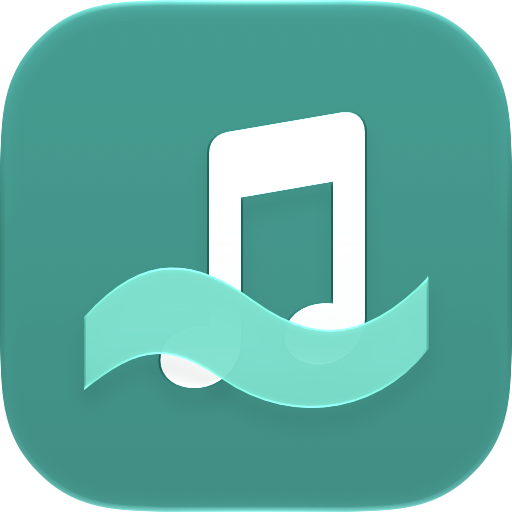

<p align="center">
  
</p>

# SurfLyrics

Spotify와 Apple Music에서 재생 중인 곡의 동기화 가사를 macOS 메뉴 막대에 표시하는 앱입니다.

**Spotify 클라이언트 → LRCLIB → Musixmatch** 순서로 가사를 찾습니다. 간주에는 대기 상태와 같은 큰 음표를 표시하고, 다음 가사가 시작되면 다시 텍스트로 바뀝니다. 시간 정보가 없는 가사는 재생 위치에 맞춘 가사로 표시하지 않습니다.

## 설치

**Apple Silicon Mac · macOS 27 이상**이 필요합니다.

### Homebrew

```sh
brew install --cask aloedawn/tap/surflyrics
```

업데이트:

```sh
brew upgrade --cask surflyrics
```

### GitHub Releases

1. [Releases](https://github.com/aloedawn/SurfLyrics/releases)에서 최신 `SurfLyrics-*-macOS-arm64.dmg`를 다운로드합니다.
2. DMG를 열고 **SurfLyrics.app**을 **Applications** 폴더로 드래그합니다.
3. 첫 실행 후 메뉴 막대에서 **설정 → 가사 소스**를 확인하고, **음악 앱 자동화 권한**을 허용합니다.

Spotify 데스크톱 앱에 로그인된 상태에서 **Spotify 가사 자동 연결 (개인용)**이 켜져 있으면, 별도 도우미나 터미널 실행 없이 앱이 직접 연결을 준비합니다. 연결이 필요할 때 Spotify가 잠시 재시작될 수 있으며, 기존 연결이 있으면 그대로 사용합니다.

**[설치 및 문제 해결 →](docs/INSTALL.md)** · **[개발 및 릴리스 →](docs/DEVELOPMENT.md)**

## 동작과 제한

- App Sandbox 외부에서 Hardened Runtime으로 동작하며, 재생 정보 조회는 `NSAppleScript` 대신 직접 Apple Events를 사용합니다.
- 재생 중인 앱이 없을 때는 주기적 타이머를 멈춰 유휴 CPU 깨우기를 줄이고, 앱 실행·종료·절전 해제 알림으로 상태를 복구합니다.
- 가사 라인 전환은 자체 재생 시계(`lyricTimer`)로 처리하며, 탐색·변동 보정만 저빈도 동기화(`syncTimer`)로 확인합니다.
- 재연결 중 같은 곡이 선택되어 있으면 재생 위치와 재생·일시정지 상태를 복구합니다. 사용자가 바꾼 곡을 이전 곡으로 되돌리지 않습니다.
- 연결 실패 시 켜져 있는 다음 가사 소스로 넘어갑니다. 반복 재시작을 막기 위해 자동 재시도에는 대기 시간이 있습니다.
- 로컬 디버깅 연결은 `127.0.0.1:43827`에만 열리며, Spotify를 완전히 종료하면 연결도 닫힙니다.
- Spotify 세션 안에서 가사를 요청하며 쿠키와 접근 토큰을 복사하거나 저장하지 않습니다. Spotify 내부 구조 변경으로 연결이 깨질 수 있어 **모든 곡의 100% 수신을 보장하지 않습니다**.

## 프로젝트 구성

| 경로 | 내용 |
| --- | --- |
| `SurfLyrics/` | 메뉴 막대 앱, 직접 Apple Events 탐지, 가사 공급자, 자동 연결, Icon Composer 원본 |
| `SurfLyricsTests/` | Apple Event·가사 매칭·우선순위·캐시·타이머 회귀 검사 |
| `scripts/` | Developer ID 패키징, Cask 렌더링, GitHub/Homebrew 릴리스 스크립트, 브리지 검사 |
| `docs/` | 설치·개발 안내와 아이콘 미리보기 |

## 라이선스

[GNU GPL v3](LICENSE). 가사의 권리는 각 권리자에게 있으며, 이 저장소에는 실제 가사나 Spotify 인증 정보가 포함되어 있지 않습니다.
